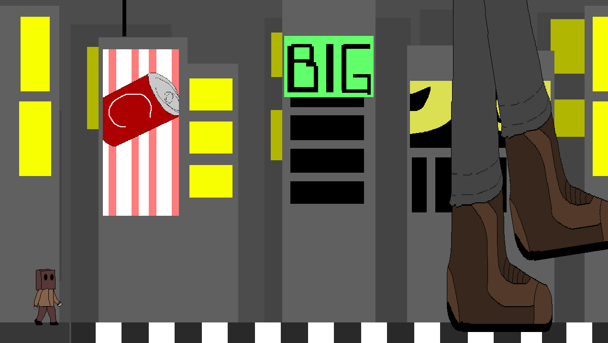
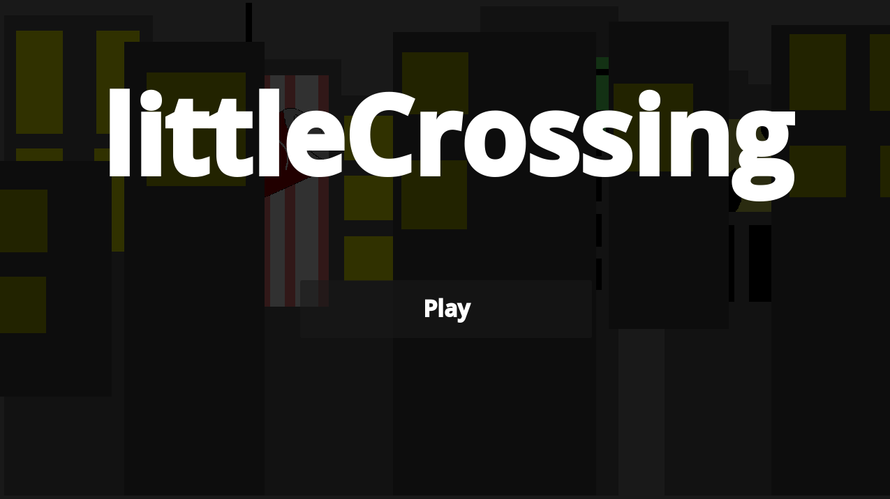

# **littleCrossing**

This is a tiny game where you're a small guy in a world where everything is huge. You need to cross the road while avoiding getting crushed by the people crossing the road, which are much bigger than you!!

## Demo

[Play the demo by clicking here!](https://littlecrossing.vercel.app/)

## Tools and technologies used

- This game was made using the [Godot engine](https://godotengine.org/)
- All game art was made in [Asperite](https://www.aseprite.org/)
    - checkout [assets/](./assets/)
- All game sound/music was made using [beepbox](https://www.beepbox.co/)
    - checkout [sounds/](./sounds)
## License

This game is licensed under MIT license.